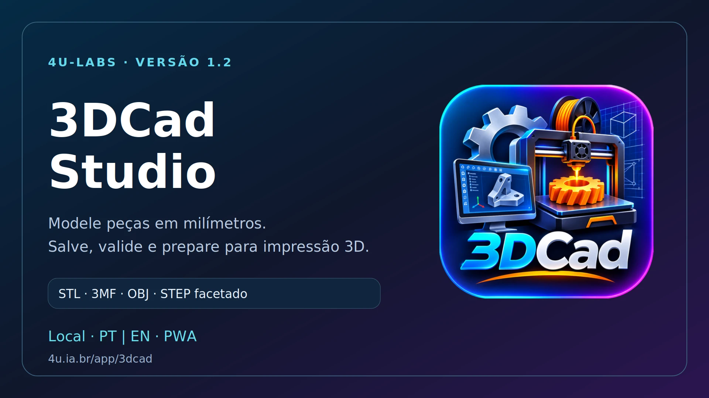

O **3DCad Studio 1.3** marca a evolução da plataforma para uma arquitetura **Dual-Engine CAD**, unindo a agilidade da modelagem paramétrica por malhas CSG à precisão analítica de engenharia através do núcleo **Open CASCADE Technology (v7.8)** e **Replicad** compilados em WebAssembly. O estúdio roda 100% no navegador e offline, preservando privacidade total e zero instalação.

[Abrir o 3DCad Studio](https://4u.ia.br/app/3dcad/) · [Código e documentação](https://github.com/4u-Labs/3dcad) · [Release 1.3.0](https://github.com/4u-Labs/3dcad/releases/tag/v1.3.0)

### O Melhor dos Dois Mundos: Malhas CSG + Sólidos BRep Exatos

Para atender tanto a prototipagem rápida e fatiamento 3D quanto a engenharia mecânica de alta precisão, o 3DCad Studio agora opera com dois motores geométricos integrados:

1. **Motor de Malhas Paramétricas (CSG):** Modelagem ágil com Three.js e CSG em milímetros, ideal para peças rápidas, modificadores visuais e geração de malhas STL, OBJ e 3MF.
2. **Núcleo BRep Exato (Open CASCADE WASM):** Geometria analítica contínua baseada em Boundary Representation (BRep), executada em segundo plano via Web Worker dedicado (`cad_worker.js`, `cad_kernel.js`). Permite operações avançadas como revoluções analíticas, concordâncias e chanfros contínuos, casca (shell) e exportação analítica padronizada em formato STEP (ISO-10303-21).

### Solver Geométrico de Esboço 2D com Análise de DOF

O novo editor de esboços 2D traz um **solver não-linear Levenberg-Marquardt amortecido** com decomposição QR Jacobian, fornecendo controle interativo e cálculo em tempo real de Graus de Liberdade (DOF - *Degrees of Freedom*):

- **16 tipos de restrições geométricas e dimensionais:** Horizontal, Vertical, Coincidente, Distância/Comprimento, Tangente, Perpendicular, Paralela, Igualdade de Raio/Comprimento, Concêntrica, Ponto Fixo e Ângulo.
- **Badge de Status de DOF:** Sinaliza visualmente se o esboço está sub-restringido (*Under-constrained*), totalmente restringido (*Fully-constrained*) ou sobre-restringido (*Over-constrained*).
- **Extração Automática de Loops e Furos:** O extrator topológico identifica automaticamente o perfil externo e laços fechados internos para operações de extrusão ou revolução 360° em sólidos com furos concêntricos precisos.

### Montagens Cinemáticas com Juntas e Simulação

A aba **Montagem** no painel de propriedades permite estruturar múltiplos corpos e conectá-los por juntas mecânicas padronizadas:

- **Juntas Suportadas:** Fixa (*Fixed*), Revoluta (*Revolute* - rotação com limites angulares em graus), Deslizante (*Slider* - translação com curso mínimo e máximo em mm) e Esférica (*Ball*).
- **Cinemática Direta em Tempo Real:** Controle deslizante interativo para movimentar juntas individualmente no viewport 3D respeitando batentes mecânicos.
- **Animação Cinemática:** Modo de teste dinâmico contínuo (`Animate Joints`) para validar folgas, encaixes e interferências.

### Histórico Paramétrico e Árvore de Operações

O grafo paramétrico (`ParametricHistoryGraph`) registra a linhagem hierárquica de recursos (primitivas, extrusões, revoluções, booleanas BRep, concordâncias e chanfros). Ao alterar uma dimensão ou restrição na base do projeto, o grafo recalcula em cascata todos os passos dependentes, preservando as operações posteriores.

### Servidor MCP (Model Context Protocol) para Automação por IA

O 3DCad Studio inclui uma implementação completa de servidor MCP (`mcp_server.cjs`) compatível com agentes de IA (Claude Desktop, Cursor, Gemini CLI, Antigravity):

- **8 Ferramentas CAD:** `cad_create_solid`, `cad_sketch_solve`, `cad_revolve`, `cad_edge_finish`, `cad_add_joint`, `cad_export_step`, `cad_get_scene`, `cad_clear_scene`.
- **2 Recursos Expostos:** `cad://scene` (árvore do projeto e estatísticas da cena) e `cad://joints` (definição cinemática das montagens).

### Validação Técnica e Confiabilidade

A versão 1.3.0 foi submetida a uma bateria abrangente de **51 testes automatizados**, assegurando:
- Convergência do solver 2D em menos de 50ms para laços complexos;
- Integridade volumétrica analítica exata em esferas, cilindros e cones BRep;
- Tolerância micrométrica na exportação e importação de arquivos STEP analíticos via Open CASCADE;
- Persistência íntegra em IndexedDB e compatibilidade regressiva absoluta com projetos legados v2;
- Isolamento estrito de cache PWA com atualização atômica para `3dcad-studio-v1.3.0`.

[Experimente o aplicativo](https://4u.ia.br/app/3dcad/) · [Conheça a 4u-Labs](https://github.com/4u-Labs) · [Apoie o desenvolvimento](https://www.paypal.com/ncp/payment/L7YRCS984T33N)

**3DCad Studio 1.3** marks the evolution of the platform into a **Dual-Engine CAD** architecture, combining the speed of CSG parametric mesh modeling with engineering-grade analytical precision powered by **Open CASCADE Technology (v7.8)** and **Replicad** compiled to WebAssembly. The studio runs 100% in-browser and offline, ensuring total privacy and zero installation.

[Open 3DCad Studio](https://4u.ia.br/app/3dcad/) · [Source and documentation](https://github.com/4u-Labs/3dcad) · [1.3.0 release](https://github.com/4u-Labs/3dcad/releases/tag/v1.3.0)

### The Best of Both Worlds: CSG Meshes + Exact BRep Solids

To address both rapid prototyping / 3D printing and precision mechanical engineering, 3DCad Studio now operates with two complementary geometric engines:

1. **Parametric Mesh Engine (CSG):** Fast, interactive modeling with Three.js and CSG in millimeters, optimized for rapid visual iteration and standard STL, OBJ, and 3MF generation.
2. **Exact BRep Kernel (Open CASCADE WASM):** Continuous analytical geometry based on Boundary Representation (BRep), executed in the background via a dedicated Web Worker (`cad_worker.js`, `cad_kernel.js`). Enables advanced operations including true revolution solids, continuous fillets and chamfers, shelling, and standardized analytical STEP (ISO-10303-21) export.

### 2D Geometric Sketch Solver with Live DOF Analysis

The rebuilt 2D sketcher features a **damped Levenberg-Marquardt non-linear solver** with QR Jacobian decomposition, offering interactive manipulation and real-time tracking of Degrees of Freedom (DOF):

- **16 geometric and dimensional constraints:** Horizontal, Vertical, Coincident, Distance/Length, Tangent, Perpendicular, Parallel, Equal Radius/Length, Concentric, Fix Point, and Angle.
- **Live DOF Status Badge:** Real-time indicator displaying Under-constrained, Fully-constrained, or Over-constrained state.
- **Automatic Wire and Hole Extraction:** Topological loop detector automatically separates outer profiles and internal closed loops for extrusion or 360° revolve operations with precise concentric bores.

### Kinematic Assemblies with Joints and Simulation

The **Assembly** tab in the properties inspector allows structuring multi-body assemblies connected by standardized mechanical joints:

- **Supported Joint Types:** Fixed, Revolute (rotational with angle limits in degrees), Slider (linear prismatic translation with stroke limits in mm), and Ball (spherical 3-DOF).
- **Real-Time Forward Kinematics:** Interactive joint test slider to drive individual kinematics in the 3D viewport while respecting physical motion limits.
- **Kinematic Animation:** Continuous dynamic preview mode (`Animate Joints`) to verify clearances, fits, and assembly motion.

### Parametric History Graph & Feature Tree

The dependency graph (`ParametricHistoryGraph`) tracks the hierarchical lineage of modeling features (primitives, extrusions, revolves, BRep booleans, fillets, chamfers). Modifying any foundational sketch dimension or primitive automatically recalculates downstream features step-by-step.

### MCP (Model Context Protocol) Server for AI Automation

3DCad Studio includes a complete Model Context Protocol server (`mcp_server.cjs`) designed for AI agent integration (Claude Desktop, Cursor, Gemini CLI, Antigravity):

- **8 CAD Tools:** `cad_create_solid`, `cad_sketch_solve`, `cad_revolve`, `cad_edge_finish`, `cad_add_joint`, `cad_export_step`, `cad_get_scene`, `cad_clear_scene`.
- **2 Resources:** `cad://scene` (live scene tree and geometry stats) and `cad://joints` (kinematic assembly joint definitions).

### Technical Validation & Reliability

Version 1.3.0 is verified by a test suite of **51 automated tests**, validating:
- Sub-50ms solver convergence on multi-constraint geometric loops;
- Mathematical analytical volume precision across BRep spheres, cylinders, and cones;
- Micrometric accuracy in analytical STEP roundtrips via Open CASCADE;
- Reliable IndexedDB autosave and 100% backward compatibility with legacy v2 projects;
- Strict PWA cache scoping with atomic migration to cache `3dcad-studio-v1.3.0`.

[Try the application](https://4u.ia.br/app/3dcad/) · [Explore 4u-Labs](https://github.com/4u-Labs) · [Support development](https://www.paypal.com/ncp/payment/L7YRCS984T33N)

