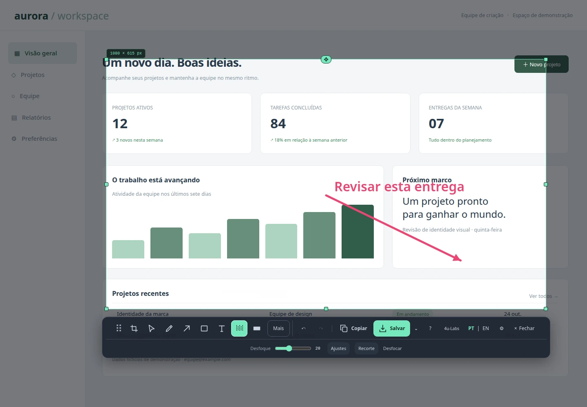

O **4uCapture** é a suíte definitiva para captura de tela, anotações técnicas e extração óptica de texto (OCR) diretamente no navegador Chromium (Chrome, Edge, Brave) e através do seu **Web Studio** multiplataforma. Construído sob a arquitetura Manifest V3 com foco absoluto em privacidade e processamento client-side, o 4uCapture elimina a dependência de serviços em nuvem para tarefas essenciais de documentação e suporte visual.

[Acessar 4uCapture Web Studio](https://4u.ia.br/app/4uCapture/) · [Código-Fonte no GitHub](https://github.com/4u-Labs/4ucapture) · [Ecossistema 4U.IA.BR](https://4u.ia.br/)

### Funcionalidades em Destaque

- 📸 **Modos de Captura Versáteis:** Captura com 1 clique da aba ativa, seleção livre retangular com precisão de pixel e captura de página inteira com rolagem vertical automática integrada.
- ✏️ **Marcações Vetoriais Reeditáveis:** Adicione setas direcionais, caixas delimitadoras, números sequenciais de passos, balões de texto e formas geométricas livres que permanecem totalmente editáveis até a exportação final.
- 🔍 **Lupa de Alta Precisão & Zoom:** Lupa 4x para inspeção detalhada de pixels em interfaces, medição de alinhamentos e conferência de layouts visuais.
- 🔒 **Tarja Anti-Forense & Mosaico:** Oculte dados sensíveis, senhas, chaves de API e informações confidenciais com filtros de desfoque gaussiano e pixelização destrutiva irreversível.
- 🧠 **OCR Local PT/EN (Tesseract WASM):** Reconhecimento óptico de caracteres em português e inglês executado 100% no dispositivo do usuário via WebAssembly, sem enviar nenhum byte para servidores externos.
- 💾 **Exportação & Integração:** Salve em PNG de alta definição, WebP otimizado ou copie instantaneamente para a área de transferência do sistema operacional.

[Experimentar o 4uCapture Online](https://4u.ia.br/app/4uCapture/) · [Explorar o Perfil 4u-Labs](https://github.com/4u-Labs)

**4uCapture** is the definitive suite for screen capture, technical annotation, and optical character recognition (OCR) running directly within Chromium-based browsers (Chrome, Edge, Brave) and via its cross-platform **Web Studio**. Designed under the Manifest V3 architecture with a strict client-side privacy model, 4uCapture eliminates cloud reliance for documentation, troubleshooting, and visual workflows.

[Open 4uCapture Web Studio](https://4u.ia.br/app/4uCapture/) · [Source Code on GitHub](https://github.com/4u-Labs/4ucapture) · [4U.IA.BR Ecosystem](https://4u.ia.br/)

### Key Features

- 📸 **Versatile Capture Modes:** 1-click active tab snapshot, pixel-perfect rectangular area selection, and automatic full-page scrolling capture.
- ✏️ **Re-editable Vector Annotations:** Directional arrows, bounding boxes, step numbering badges, callout notes, and geometric shapes that remain non-destructive until export.
- 🔍 **High-Precision Magnifier:** 4x optical loupe for fine UI inspection, margin checking, and visual debugging.
- 🔒 **Redaction & Mosaic Privacy:** Permanently blur or pixelate sensitive credentials, API keys, and personal data with irreversible canvas filters.
- 🧠 **Offline Local OCR (Tesseract WASM):** Instant optical character recognition in Portuguese and English running entirely client-side via WebAssembly without external server uploads.
- 💾 **Quick Export & Copy:** Save to crystal-clear PNG, lightweight WebP, or copy directly to your OS clipboard in one stroke.

[Try 4uCapture Online](https://4u.ia.br/app/4uCapture/) · [Explore 4u-Labs](https://github.com/4u-Labs)

