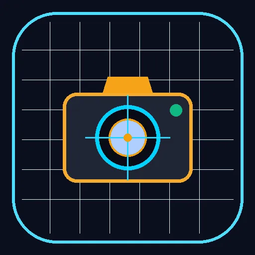

O **CamObra Pro** é uma solução de engenharia de campo desenvolvida especificamente para fiscalização de obras civis, infraestrutura viária, concessões de rodovias e perícias técnicas. Operando como Progressive Web App (PWA) de alto desempenho, o aplicativo funciona diretamente na câmera do smartphone ou tablet, permitindo o registro fotográfico com carimbo pericial inviolável, telemetria completa e geração imediata de laudos técnicos em pranchas A4.

[Acessar CamObra Pro](https://4u.ia.br/app/camobra/) · [Repositório GitHub](https://github.com/4u-Labs/camobra) · [Ecossistema 4U.IA.BR](https://4u.ia.br/)

### Recursos Especializados para Engenharia

- 📍 **Telemetria de Campo em Tempo Real:** Captura contínua de coordenadas geodésicas (Latitude/Longitude WGS84) e conversão automática para o sistema cartográfico **UTM (Universal Transverse Mercator)**, essencial para projetos viários e topografia.
- 🧭 **Bússola Digital & Azimute:** Marcação do rumo e azimute da tomada fotográfica, garantindo orientação solar e espacial inequívoca para laudos periciais.
- 🫧 **Inclinômetro & Nível de Bolha Virtual:** Verificação de prumo e nivelamento estrutural em tempo real direto na tela antes do disparo.
- 🏷️ **Carimbo Técnico Indelével:** Registro gravado sobre a imagem contendo identificação da obra, estaca/km, responsável técnico, data, hora e dados georreferenciados.
- 📄 **Exportação de Laudos em PDF A4:** Montagem instantânea de relatórios fotográficos organizados em pranchas com descritivos técnicos prontos para entrega a órgãos fiscalizadores.
- 🛡️ **Operação 100% Offline (PWA):** Armazenamento local em IndexedDB que permite fiscalizações completas em canteiros remotos sem cobertura de sinal de internet.

[Abrir o CamObra Pro no Navegador](https://4u.ia.br/app/camobra/) · [Conhecer Outras Ferramentas de Engenharia](https://github.com/4u-Labs)

**CamObra Pro** is a field engineering camera tailored for civil inspections, highway concessions, industrial installations, and forensic site audits. Engineered as a high-performance Progressive Web App (PWA), it runs directly within mobile browsers, enabling field inspectors to record photographs with indelible forensic metadata, real-time spatial telemetry, and automated A4 inspection sheets.

[Open CamObra Pro](https://4u.ia.br/app/camobra/) · [Source Code on GitHub](https://github.com/4u-Labs/camobra) · [4U.IA.BR Ecosystem](https://4u.ia.br/)

### Key Engineering Features

- 📍 **Real-Time Field Telemetry:** Live GPS capture (Latitude/Longitude WGS84) with automated on-device projection into the **UTM (Universal Transverse Mercator)** cartographic system.
- 🧭 **Digital Compass & True Azimuth:** Precise direction heading recorded on every capture, establishing clear orientation for technical and legal documentation.
- 🫧 **3D Gyroscopic Level:** Real-time digital bubble level ensuring plumb and horizontal alignment before image capture.
- 🏷️ **Tamper-Evident Technical Stamp:** Indelible overlay embedding project ID, stationing/chainage (KM), inspector signature, exact timestamp, and coordinates.
- 📄 **Instant A4 PDF Reports:** Automated compilation of inspection photos into standardized engineering pranchas with technical notes.
- 🛡️ **100% Offline Resilience (PWA):** Local IndexedDB persistence ensuring seamless inspections in remote rural or underground worksites without internet connectivity.

[Try CamObra Pro Online](https://4u.ia.br/app/camobra/) · [Explore 4u-Labs Repositories](https://github.com/4u-Labs)

