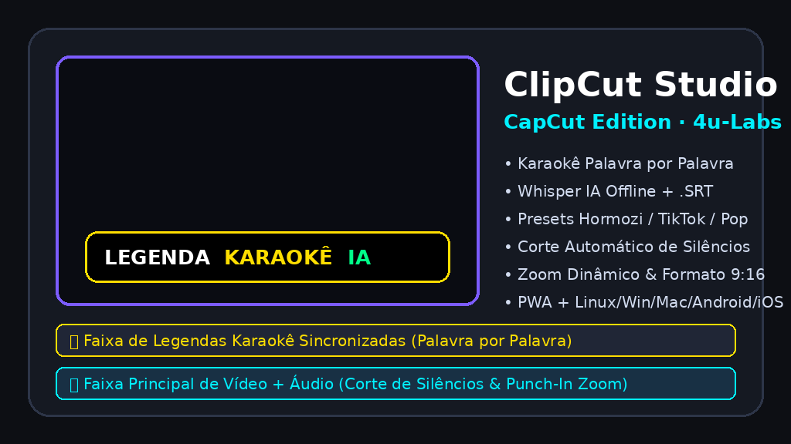

O **ClipCut Studio 1.0.0** chega como a primeira release estável do editor nativo da 4U-Labs. A nova versão reúne ferramentas para montar vídeo, organizar faixas de áudio e texto e finalizar projetos no computador ou no celular. A interface web continua disponível para edições rápidas.

### Edição na timeline

A timeline multifaixa organiza vídeo, áudio e legendas com régua de tempo, formas de onda e controles de corte. O editor inclui desfazer/refazer, ajustes de keyframes, velocidade e transições. Projetos podem ser salvos no formato `.clipcut` para continuar a edição.

### Áudio e legendas

O ClipCut oferece recursos para editar áudio, transcrever fala com Whisper e estilizar legendas, incluindo destaque de palavras. O processamento dos arquivos de mídia ocorre no dispositivo. O download inicial dos modelos de IA depende da conexão e do recurso escolhido.

### Versões para cada dispositivo

A release traz pacotes nativos para Linux x86_64 e ARM64, Windows x86_64, macOS Intel e Apple Silicon ARM64, Android ARM64 e iOS. A versão PWA também pode ser aberta e instalada no navegador. Requisitos e métodos de instalação variam conforme o sistema; consulte as notas e os checksums na página de releases.

### Baixar e experimentar

- [Abrir o ClipCut Studio no navegador](https://4u.ia.br/app/clipcut/)
- [Baixar ClipCut Studio 1.0.0](https://github.com/4u-Labs/clipcut/releases/tag/v1.0.0)
- [Código-fonte no GitHub](https://github.com/4u-Labs/clipcut)
- [Aplicativos da 4U-Labs](https://4u.ia.br/loja/)

**ClipCut Studio 1.0.0** is the first stable release of 4U-Labs' native editor. It brings together tools to assemble video, arrange audio and text tracks, and finish projects on desktop or mobile. The web interface remains available for quick edits.

### Editing on the timeline

The multitrack timeline organizes video, audio and captions with a time ruler, waveforms and trimming controls. The editor includes undo/redo, keyframe adjustments, speed controls and transitions. Projects can be saved in the `.clipcut` format and reopened for further editing.

### Audio and captions

ClipCut includes audio editing, Whisper speech transcription and caption styling, including word highlights. Media files are processed on the device. The initial download of AI models requires a connection and depends on the feature selected.

### Builds for different devices

This release provides native packages for Linux x86_64 and ARM64, Windows x86_64, Intel and Apple Silicon ARM64 macOS, Android ARM64 and iOS. The PWA can also be opened and installed from a browser. Requirements and installation methods vary by system; check the release notes and checksums before installing.

### Download and try it

- [Open ClipCut Studio in the browser](https://4u.ia.br/app/clipcut/)
- [Download ClipCut Studio 1.0.0](https://github.com/4u-Labs/clipcut/releases/tag/v1.0.0)
- [Source code on GitHub](https://github.com/4u-Labs/clipcut)
- [Explore 4U-Labs apps](https://4u.ia.br/loja/)

