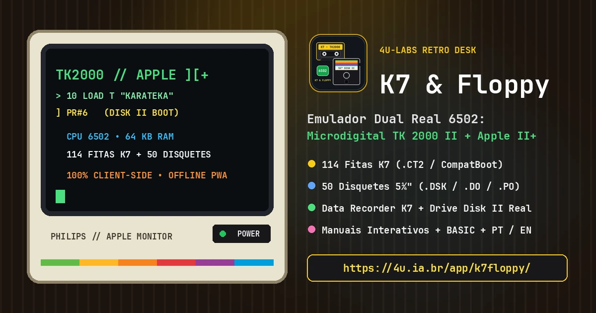

O **K7 & Floppy** traz de volta dois marcos inesquecíveis da computação pessoal dos anos 80 em uma bancada de madeira realista diretamente no navegador: o brasileiro **Microdigital TK 2000 II** (com seu gravador **Data Recorder K7**) e o clássico **Apple II+** (com o lendário drive **Disk II 5¼"**). Totalmente **100% client-side**, sem necessidade de plugins ou servidores de streaming, o projeto executa em JavaScript puro a CPU **MOS 6502**, vídeo NTSC/Hi-Res e áudio de alto-falante 1-bit via Web Audio API.

[Abrir K7 & Floppy Online](https://4u.ia.br/app/k7floppy/) · [Código-Fonte & Packs ZIP no GitHub](https://github.com/4u-Labs/k7floppy) · [Ecossistema 4U.IA.BR](https://4u.ia.br/)

### Funcionalidades em Destaque

- 🖥️ **Alternância Instantânea (TK 2000 II ↔ Apple II+):** Troca em tempo real todo o chassi, placa metálica, monitor CRT, teclado e periféricos da escrivaninha — exibindo apenas o gravador K7 e fitas no modo TK 2000, ou apenas o drive Disk II e disquetes 5¼" no modo Apple II+.
- 📼 **110+ Fitas K7 no TK 2000 (.CT2, .WAV & CompatBoot):** Carregue programas reais via `LOAD T` / `⚡ Auto-Load`, grave suas criações em BASIC com `SAVE T "NOME"` e jogue mais de uma centena de títulos preservados diretamente como fitas K7.
- 💾 **50 Disquetes 5¼" de Apple II+ (.DSK / .DO / .PO):** Biblioteca curada com clássicos como *Karateka*, *Choplifter*, *Championship Lode Runner*, *Prince of Persia*, *Boulder Dash* e *Castle Wolfenstein*, com busca rápida, filtros e Caixa de Disquetes visual.
- 🕹️ **Detecção Automática de Teclas & Joystick:** Inspeciona a memória RAM ativa em busca de leituras de joystick (`$C064/$C061`) ou teclado e exibe dicas instantâneas de controles para cada jogo.
- 📖 **Manuais Interativos & Modo Bilíngue PT/EN:** Guias de operação e referências buscáveis de comandos **TK-BASIC** e **Applesoft BASIC** direto na mesa, com suporte completo a PWA offline e download opcional dos pacotes [`tk2000.zip` e `appleii.zip` via GitHub Releases](https://github.com/4u-Labs/k7floppy/releases/tag/v1.0.0).

[Experimentar K7 & Floppy Online](https://4u.ia.br/app/k7floppy/) · [Explorar o Perfil 4u-Labs](https://github.com/4u-Labs)

**K7 & Floppy** brings back two unforgettable landmarks of 1980s personal computing on a realistic wooden retro desk directly inside your web browser: Brazil's **Microdigital TK 2000 II** (with its **Data Recorder K7** cassette deck) and the classic **Apple II+** (with its **Disk II 5¼"** floppy drive). Running **100% client-side** with zero external plugins, the emulator implements a cycle-accurate **MOS 6502 CPU**, Hi-Res CRT display modes, and 1-bit Web Audio speaker synthesis.

[Open K7 & Floppy Online](https://4u.ia.br/app/k7floppy/) · [Source Code & ZIP Packs on GitHub](https://github.com/4u-Labs/k7floppy) · [4U.IA.BR Ecosystem](https://4u.ia.br/)

### Key Features

- 🖥️ **Instant Machine Switching (TK 2000 II ↔ Apple II+):** Dynamically transforms the hardware chassis, CRT bezel, keyboard, and desk peripherals — showing only the cassette deck & tapes in TK 2000 mode, or only the Disk II drive & 5¼" floppies in Apple II+ mode.
- 📼 **110+ TK 2000 Cassette Tapes (.CT2, .WAV & CompatBoot):** Load authentic tapes via `LOAD T` / `⚡ Auto-Load`, record your own BASIC programs with `SAVE T "NAME"`, and launch over a hundred preserved TK 2000 titles right from the cassette rack.
- 💾 **50 Classic Apple II+ 5¼" Floppies (.DSK / .DO / .PO):** Curated library featuring *Karateka*, *Choplifter*, *Championship Lode Runner*, *Prince of Persia*, *Boulder Dash*, and *Castle Wolfenstein*, complete with live search, category pills, and a full-screen Disk Box drawer.
- 🕹️ **Automatic RAM Control & Joystick Detection:** Scans active memory reads (`$C064/$C061` and keyboard strobes) to surface accurate per-game keyboard and joystick hints in real time.
- 📖 **Interactive Manuals & Bilingual PT/EN UI:** Searchable **TK-BASIC** and **Applesoft BASIC** command references on the desk, offline PWA support, and optional full archive downloads ([`tk2000.zip` and `appleii.zip` on GitHub Releases](https://github.com/4u-Labs/k7floppy/releases/tag/v1.0.0)).

[Try K7 & Floppy Online](https://4u.ia.br/app/k7floppy/) · [Explore 4u-Labs Repositories](https://github.com/4u-Labs)

