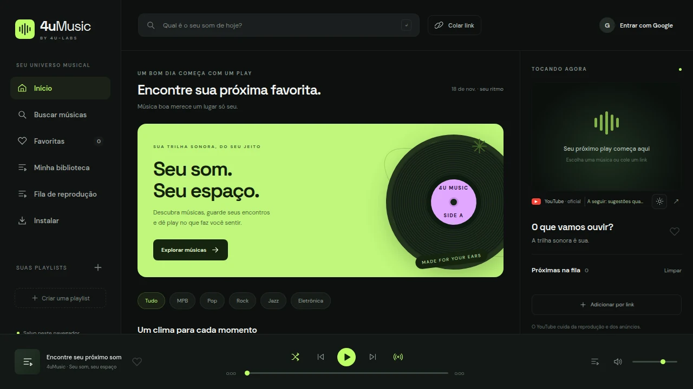

O **4uMusic** é um reprodutor musical progressivo (PWA) projetado para entregar organização limpa de faixas, busca rápida, perfis dedicados de artistas e continuidade de reprodução sem poluição visual ou distrações.

[Abrir 4uMusic Online](https://4u.ia.br/app/4umusic/) · [Código-Fonte no GitHub](https://github.com/4u-Labs/4umusic) · [Ecossistema 4U.IA.BR](https://4u.ia.br/)

### Funcionalidades em Destaque

- 🚀 🎵 **Busca Oficial & Páginas de Artistas:** Explore discografias, mixes temáticos ajustáveis e faixas em uma interface escura responsiva.
- ⚡ 📂 **Playlists & Biblioteca Persistente:** Crie listas personalizadas, organize filas de reprodução e salve o histórico recente automaticamente.
- 🔒 🔋 **Screen Wake Lock & Controle de Sessão:** Mantém o dispositivo ativo durante apresentações ou treinos e retoma exatamente do ponto em que você parou.
- 💾 📱 **PWA Instalável:** Funciona como aplicativo dedicado no desktop e no smartphone com carregamento instantâneo.

[Experimentar Online](https://4u.ia.br/app/4umusic/) · [Explorar o Perfil 4u-Labs](https://github.com/4u-Labs)

**4uMusic** is a clean Progressive Web App (PWA) music player engineered for streamlined track discovery, artist pages, custom playlists, and uninterrupted playback continuity without visual clutter.

[Open 4uMusic Online](https://4u.ia.br/app/4umusic/) · [Source Code on GitHub](https://github.com/4u-Labs/4umusic) · [4U.IA.BR Ecosystem](https://4u.ia.br/)

### Key Features

- 🚀 🎵 **Official Search & Artist Views:** Browse tracks, artist catalogs, and tunable mixes in a responsive dark-mode interface.
- ⚡ 📂 **Persistent Playlists & Queue Management:** Curate personal collections and manage playback queues with automatic state saving.
- 🔒 🔋 **Screen Wake Lock & Session Resume:** Prevents screen dimming when desired and resumes your listening session right where you left off.
- 💾 📱 **Installable PWA Experience:** Install directly onto desktop or mobile home screens for fast, app-like access.

[Try Online](https://4u.ia.br/app/4umusic/) · [Explore 4u-Labs Repositories](https://github.com/4u-Labs)

