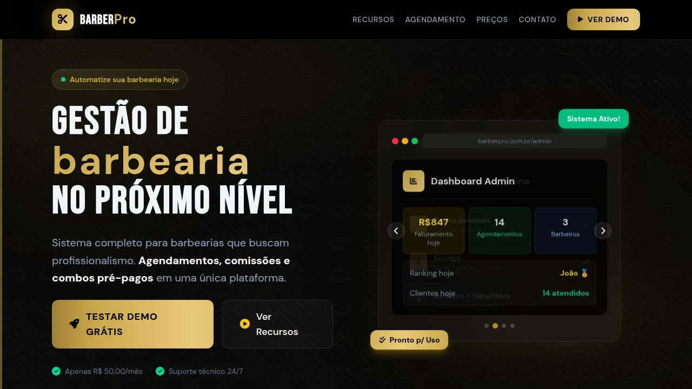

O **Barber Pro** é a plataforma SaaS do ecossistema **4U.IA.BR** desenvolvida para automatizar o dia a dia de barbearias modernas. Com foco em experiência do cliente e controle operacional, o sistema reúne agenda online, cálculo automático de comissões por profissional e planos ou combos pré-pagos em um painel único.

[Acessar Barber Pro](https://4u.ia.br/saas/sist/barbearia/) · [Catálogo na Loja 4U](https://4u.ia.br/loja/) · [Ecossistema 4U.IA.BR](https://4u.ia.br/)

### Funcionalidades em Destaque

- 🚀 **Agendamento Online Simplificado:** Clientes escolhem barbeiro, serviço, data e horário disponíveis direto pelo navegador sem baixar aplicativo.
- ⚡ **Dashboard Administrativo & Financeiro:** Acompanhe faturamento diário, número de atendimentos, ranking da equipe e serviços mais procurados em tempo real.
- 🔒 **Comissões & Combos Pré-Pagos:** Controle automático de repasses por profissional, pacotes recorrentes e fidelização de clientes.
- 💾 **Arquitetura Web Responsiva:** Funciona em smartphones, tablets de recepção e computadores com demonstração aberta para testes.

[Testar Demo do Barber Pro](https://4u.ia.br/saas/sist/barbearia/) · [Explorar o Perfil 4u-Labs](https://github.com/4u-Labs)

**Barber Pro** is a **4U.IA.BR** SaaS platform built to streamline modern barbershop operations. Focused on effortless client booking and back-office clarity, it combines online scheduling, automated barber commission tracking, and prepaid service packages in one dashboard.

[Open Barber Pro](https://4u.ia.br/saas/sist/barbearia/) · [4U App Hub](https://4u.ia.br/loja/) · [4U.IA.BR Ecosystem](https://4u.ia.br/)

### Key Features

- 🚀 **Frictionless Online Booking:** Customers pick their barber, service, date, and open time slot directly in the browser without installing an app.
- ⚡ **Live Admin & Revenue Dashboard:** Track daily revenue, appointment volume, team leaderboard rankings, and top services at a glance.
- 🔒 **Automated Commissions & Prepaid Combos:** Clean tracking of staff payouts, recurring plans, and prepaid haircut combos.
- 💾 **Mobile-First Web Workspace:** Runs smoothly on phones, reception tablets, and desktops with an interactive live demo.

[Try Barber Pro Live Demo](https://4u.ia.br/saas/sist/barbearia/) · [Explore 4u-Labs Profile](https://github.com/4u-Labs)

