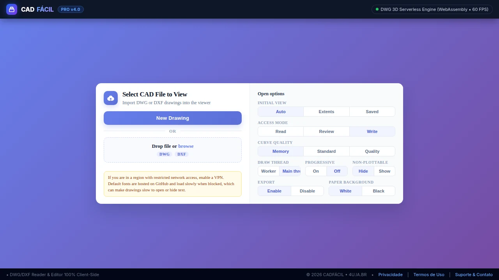

O **CADFÁCIL 3D** entrega uma estação leve e rápida para engenheiros, arquitetos e projetistas visualizarem, rotacionarem em 3D, conferirem cotas e gerenciarem camadas de arquivos técnicos **DWG** e **DXF** diretamente do navegador.

[Abrir CADFÁCIL 3D Online](https://4u.ia.br/app/cad/) · [Código-Fonte no GitHub](https://github.com/4u-Labs/cad) · [Ecossistema 4U.IA.BR](https://4u.ia.br/)

### Funcionalidades em Destaque

- 🚀 📐 **Leitura Nativa DWG & DXF:** Carregue pranchas e modelos técnicos instantaneamente sem depender de licenças pesadas.
- ⚡ 🧊 **Inspeção 3D & Orbitagem Suave:** Navegue por vistas isométricas, plantas baixas e elevações com zoom de precisão.
- 🔒 🗂️ **Controle de Camadas & Medição:** Ligue/desligue layers do projeto e confira distâncias e áreas diretamente na tela.
- 💾 🧩 **PWA & Extensão Dedicada:** Disponível no navegador com suporte offline e integração rápida para abertura de arquivos.

[Experimentar Online](https://4u.ia.br/app/cad/) · [Explorar o Perfil 4u-Labs](https://github.com/4u-Labs)

**CADFÁCIL 3D** gives engineers, architects, and drafters a fast web workspace to open, orbit in 3D, inspect layers, and measure technical **DWG** and **DXF** drawings directly in the browser.

[Open CADFÁCIL 3D Online](https://4u.ia.br/app/cad/) · [Source Code on GitHub](https://github.com/4u-Labs/cad) · [4U.IA.BR Ecosystem](https://4u.ia.br/)

### Key Features

- 🚀 📐 **Native DWG & DXF Support:** Open engineering sheets and blueprints quickly without heavy desktop installations.
- ⚡ 🧊 **3D Inspection & Smooth Orbit:** Navigate isometric views, floor plans, and technical sections with crisp precision.
- 🔒 🗂️ **Layer Tree & Measurement Tools:** Toggle CAD layers selectively and verify dimensions and areas directly onscreen.
- 💾 🧩 **PWA & Browser Integration:** Lightweight web footprint with companion browser extension support.

[Try Online](https://4u.ia.br/app/cad/) · [Explore 4u-Labs Repositories](https://github.com/4u-Labs)

