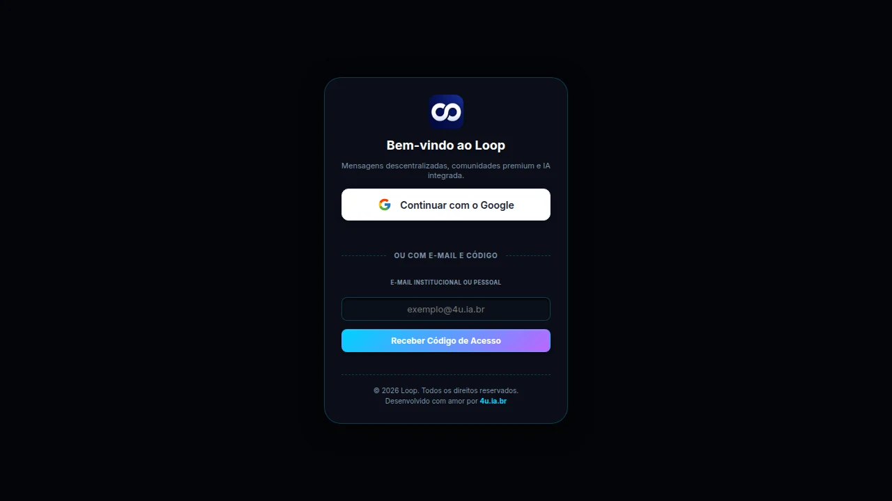

O **Loop** reúne a agilidade de um mensageiro moderno em web app progressivo com canais organizados, troca rápida de mídia, transcrição inteligente e assistência por Inteligência Artificial diretamente no fluxo da conversa.

[Abrir Loop Online](https://4u.ia.br/app/loop/) · [Código-Fonte no GitHub](https://github.com/4u-Labs/loop) · [Ecossistema 4U.IA.BR](https://4u.ia.br/)

### Funcionalidades em Destaque

- 🚀 💬 **Mensagens, Canais & Comunidades:** Organização limpa de chats individuais, grupos e canais temáticos com atualização contínua.
- ⚡ 🤖 **Copiloto de IA Integrado:** Apoio contextual, resumos e transcrição de mensagens de voz dentro da própria conversa.
- 🔒 🔐 **Privacidade & Controle de Sessão:** Autenticação protegida, armazenamento estruturado e troca segura de mensagens.
- 💾 📱 **PWA Responsivo:** Interface fluida adaptada para desktop e celular com Service Worker.

[Experimentar Online](https://4u.ia.br/app/loop/) · [Explorar o Perfil 4u-Labs](https://github.com/4u-Labs)

**Loop** combines the speed of a modern Progressive Web App messenger with organized channels, fast media sharing, voice transcription, and built-in AI assistance right inside your chat stream.

[Open Loop Online](https://4u.ia.br/app/loop/) · [Source Code on GitHub](https://github.com/4u-Labs/loop) · [4U.IA.BR Ecosystem](https://4u.ia.br/)

### Key Features

- 🚀 💬 **Chats, Channels & Communities:** Structured messaging rooms for 1-on-1 conversations, teams, and topic channels.
- ⚡ 🤖 **Built-In AI Copilot:** Contextual drafting, thread summarization, and audio message transcription right inside the thread.
- 🔒 🔐 **Protected Messaging Sessions:** Encrypted session handling and structured media storage.
- 💾 📱 **Responsive Installable PWA:** Smooth layout engineered for both desktop browsers and mobile viewports.

[Try Online](https://4u.ia.br/app/loop/) · [Explore 4u-Labs Repositories](https://github.com/4u-Labs)

