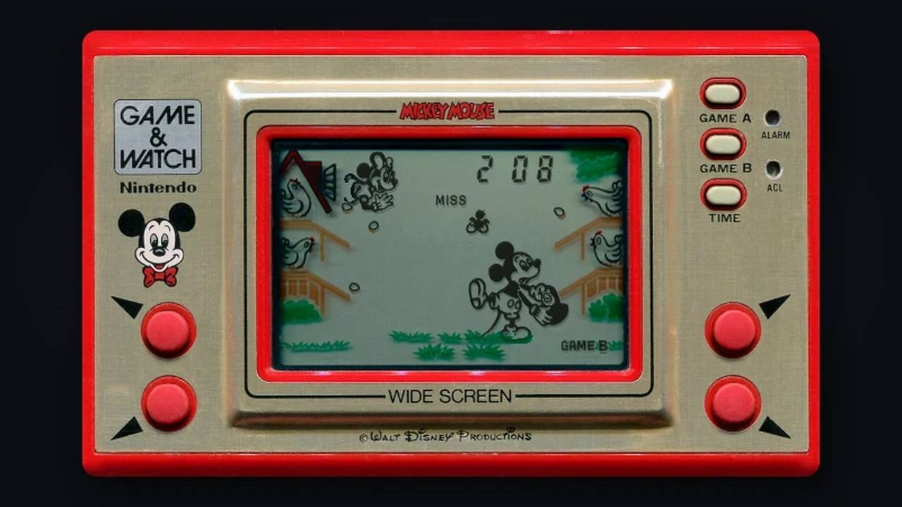

O **Game & Watch: Mickey Mouse (MC-25)** recria com fidelidade histórica o portátil de cristal líquido lançado pela Nintendo em 1981. Usando **HTML5 Canvas** e síntese sonora **Web Audio API**, cada segmento do visor LCD, efeito fantasma dos cristais desligados e resposta dos botões originais funcionam direto no navegador.

[Abrir Game & Watch Mickey Mouse (MC-25, 1981) Online](https://4u.ia.br/app/mickey/) · [Código-Fonte no GitHub](https://github.com/4u-Labs/mickey) · [Ecossistema 4U.IA.BR](https://4u.ia.br/)

### Funcionalidades em Destaque

- 🚀 🕹️ **Máquina de Estados Autêntica (Game A & Game B):** Curva de velocidade fiel ao hardware original com ovos em 4 rampas e pontuação salva localmente.
- ⚡ 📺 **Visor LCD Realista com Reflexo de Vidro:** Opção para ligar/desligar a marca d'água sutil dos segmentos inativos e vidro com brilho realista.
- 🔒 ⌚ **Modos Time, Alarm & ACL:** Relógio funcional em tempo real, configuração de alarme sonoro e botão ACL retrô no painel do console.
- 💾 📱 **Hotspots Touch & Atalhos de Teclado:** Jogue tocando diretamente nos botões do console no celular ou usando teclado (`Q/A/P/L` ou setas) em tela cheia.

[Experimentar Online](https://4u.ia.br/app/mickey/) · [Explorar o Perfil 4u-Labs](https://github.com/4u-Labs)

**Game & Watch: Mickey Mouse (MC-25)** faithfully recreates Nintendo's iconic 1981 Wide Screen LCD handheld inside modern browsers. Powered by **HTML5 Canvas** and **Web Audio API**, every LCD crystal segment, unlit ghost shadow, and physical console button responds cleanly across desktop and mobile.

[Open Game & Watch Mickey Mouse (MC-25, 1981) Online](https://4u.ia.br/app/mickey/) · [Source Code on GitHub](https://github.com/4u-Labs/mickey) · [4U.IA.BR Ecosystem](https://4u.ia.br/)

### Key Features

- 🚀 🕹️ **Authentic State Machine (Game A & Game B):** Classic egg-catching ramp progression, miss animations, and persistent local high scores.
- ⚡ 📺 **True-to-Life LCD Ghosting & Glass Sheen:** Toggle subtle inactive LCD segment silhouettes and realistic screen glass reflections.
- 🔒 ⌚ **Working Clock, Alarm & ACL Modes:** Built-in real-time clock demo, vintage beep alarm, and authentic ACL reset behavior.
- 💾 📱 **Touch Console Hotspots & Fullscreen Mode:** Tap physical casing buttons on mobile or use keyboard shortcuts (`Q/A/P/L` or arrows) in fullscreen.

[Try Online](https://4u.ia.br/app/mickey/) · [Explore 4u-Labs Repositories](https://github.com/4u-Labs)

