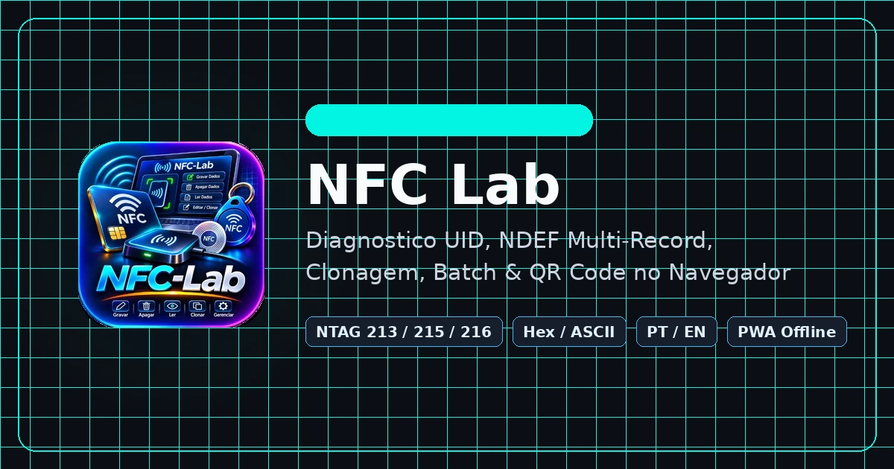

O **NFC Lab** é uma suíte completa de diagnóstico, leitura e gravação de cartões e tags **NFC** diretamente no navegador utilizando a **Web NFC API (`NDEFReader`)**. Totalmente **100% client-side**, sem anúncios, sem cadastro e sem transmissão de dados dos seus chips para servidores externos, o aplicativo transforma qualquer smartphone Android com Chrome/Edge em um gravador e inspetor NFC profissional.

[Abrir NFC Lab Online](https://4u.ia.br/app/nfclab/) · [Código-Fonte no GitHub](https://github.com/4u-Labs/nfclab) · [Ecossistema 4U.IA.BR](https://4u.ia.br/)

### Funcionalidades em Destaque

- 🔍 **Leitor & Inspetor de Hardware (UID, Hex & ASCII):** Detecta família do chip (NTAG213, NTAG215, NTAG216, Mifare Ultralight), copia instantaneamente o UID/número de série, exibe status de bloqueio (`RW`/`RO`), lista todos os registros NDEF decodificados e inclui inspetor bruto em **Hexadecimal e ASCII**.
- ✍️ **Gravador Multi-Registro NDEF em 10 Formatos:** Combine múltiplos registros na mesma tag — **URL/Link**, **Contato vCard**, **Rede Wi-Fi**, **Texto Puro**, **Telefone**, **WhatsApp/SMS**, **E-mail**, **Coordenadas GPS**, **App Android (AAR)** e **MIME Customizado** — com medidor visual em tempo real de capacidade para chips **144 B / 504 B / 888 B**.
- 📦 **Modo Lote Contínuo & Clonagem de Tags:** Replique os registros NDEF da última tag lida, grave dezenas de cartões em sequência com contador automático ou formate/bloqueie tags permanentemente.
- ⚡ **Atalhos Prontos & Exportação:** Gere com um toque tags para Wi-Fi de balcão, WhatsApp comercial, perfil do Instagram, Cartão Executivo 4U, Webhooks de automação (`n8n`/smart home), rotas do Google Maps e **QR Code** equivalente com backup de fila em `.json`.
- 📱 **Bilíngue (PT/EN) & PWA Offline:** Interface responsiva instalável como aplicativo no celular e desktop, pronta para uso em campo mesmo sem conexão constante.

[Experimentar NFC Lab Online](https://4u.ia.br/app/nfclab/) · [Explorar o Perfil 4u-Labs](https://github.com/4u-Labs)

**NFC Lab** is a complete **NFC tag diagnostic, reader, and NDEF writer suite** running directly in your browser through the **Web NFC API (`NDEFReader`)**. Built **100% client-side** with zero ads, zero logins, and zero cloud retention of your tag payloads, it turns any Android device running Chrome or Edge into a pocket-sized NFC laboratory.

[Open NFC Lab Online](https://4u.ia.br/app/nfclab/) · [Source Code on GitHub](https://github.com/4u-Labs/nfclab) · [4U.IA.BR Ecosystem](https://4u.ia.br/)

### Key Features

- 🔍 **Hardware Inspector & UID/Hex Viewer:** Identifies chip family (NTAG213, NTAG215, NTAG216, Mifare Ultralight), copies the serial UID with one tap, verifies `RW`/`RO` lock state, decodes NDEF records, and renders a raw **Hexadecimal & ASCII** payload inspector.
- ✍️ **10-Format Multi-Record NDEF Writer:** Queue multiple records onto a single tag — **URL**, **vCard Contact**, **Wi-Fi Credentials**, **Plain Text**, **Direct Phone**, **WhatsApp/SMS**, **Email**, **GPS Coordinates**, **Android Application Record (AAR)**, and **Custom MIME** — backed by a real-time capacity meter for **144 B / 504 B / 888 B** chips.
- 📦 **Continuous Batch Writing & Cloning:** Clone previously scanned NDEF payloads onto blank cards, write multiple tags sequentially with a live counter, format/erase NDEF containers, or permanently lock read-only tags.
- ⚡ **1-Tap Quick Tasks & QR Companion:** Pre-built wizards for guest Wi-Fi, WhatsApp customer support, Instagram, 4U Digital Cards, automation webhooks (`n8n`/home automation), Google Maps directions, matching **QR Code** generation, and `.json` template export/import.
- 📱 **Bilingual (PT/EN) & Installable PWA:** Clean dark telemetry UI designed for mobile field work with full offline Service Worker support.

[Try NFC Lab Online](https://4u.ia.br/app/nfclab/) · [Explore 4u-Labs Repositories](https://github.com/4u-Labs)

