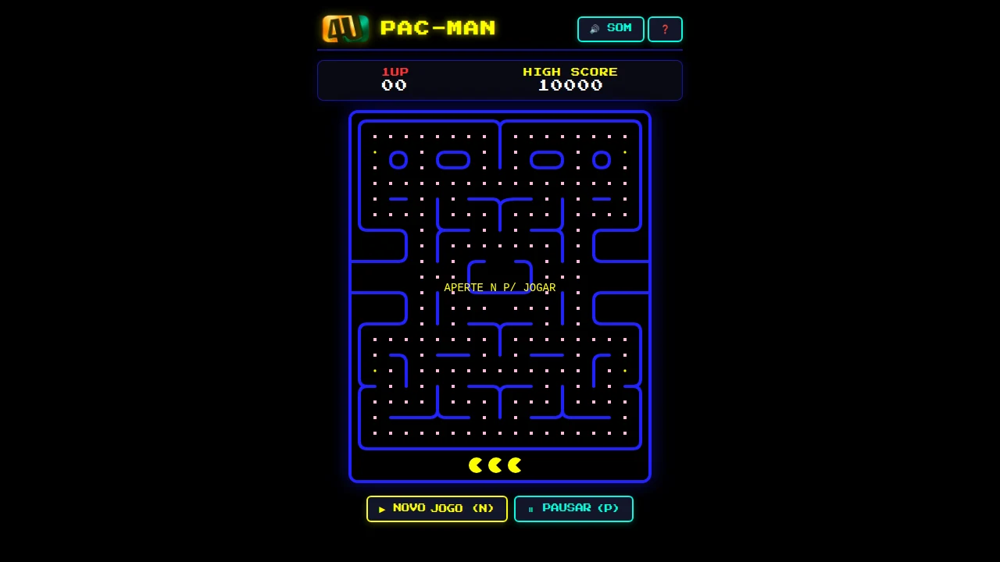

O **Pac-Man Arcade** da 4u-Labs traz o clássico labirinto arcade de volta em **HTML5 Canvas** puro a 60 FPS. Sem arquivos de áudio pesados nem dependências externas, todos os bips de pastilhas, sirenes e efeitos sonoros são sintetizados ao vivo pela **Web Audio API**.

[Abrir Pac-Man Arcade Online](https://4u.ia.br/app/pacman/) · [Código-Fonte no GitHub](https://github.com/4u-Labs/pacman) · [Ecossistema 4U.IA.BR](https://4u.ia.br/)

### Funcionalidades em Destaque

- 🚀 👻 **IA Clássica dos Fantasmas:** Comportamentos distintos de perseguição, emboscada e fuga com power-ups de vulnerabilidade.
- ⚡ 🔊 **Sintetizador Retrô em Web Audio:** Música de abertura, efeito waka-waka e sirenes gerados dinamicamente no navegador.
- 🔒 🕹️ **Teclado + D-Pad Touch Responsivo:** Jogue no PC com setas/WASD ou no celular com direcional tátil ergonômico.
- 💾 🏆 **Placar 1UP & High Score Persistente:** Acompanhe recordes locais diretamente na interface arcade instalada como PWA.

[Experimentar Online](https://4u.ia.br/app/pacman/) · [Explorar o Perfil 4u-Labs](https://github.com/4u-Labs)

4u-Labs' **Pac-Man Arcade** brings back the timeless 1980s maze-chase classic in crisp 60 FPS **HTML5 Canvas**. Every waka-waka sound, siren, and power-pellet chime is synthesized live in code via the **Web Audio API** with zero bloated external media.

[Open Pac-Man Arcade Online](https://4u.ia.br/app/pacman/) · [Source Code on GitHub](https://github.com/4u-Labs/pacman) · [4U.IA.BR Ecosystem](https://4u.ia.br/)

### Key Features

- 🚀 👻 **Classic Ghost AI Personalities:** Distinct chase, scatter, and frightened behaviors faithful to golden-age arcade mechanics.
- ⚡ 🔊 **Live Web Audio Synthesizer:** Intro fanfare, pellet chomp audio, and sirens synthesized procedurally in real time.
- 🔒 🕹️ **Keyboard & Mobile Touch D-Pad:** Seamless controls across desktop arrows/WASD and responsive smartphone touchscreens.
- 💾 🏆 **1UP & Persistent High Scores:** Local score tracking wrapped inside an installable offline-capable PWA.

[Try Online](https://4u.ia.br/app/pacman/) · [Explore 4u-Labs Repositories](https://github.com/4u-Labs)

