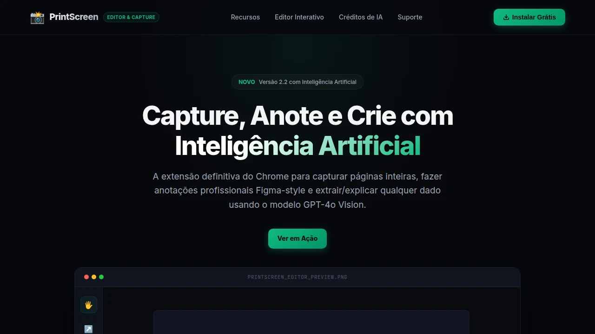

O **PrintScreen Capture** combina praticidade imediata de captura de tela com um estúdio rápido de marcações visuais no navegador. Ideal para documentar bugs, criar tutoriais e enviar feedbacks claros em equipe.

[Abrir PrintScreen Capture Online](https://4u.ia.br/app/printscreencapture/) · [Código-Fonte no GitHub](https://github.com/4u-Labs/printscreencapture) · [Ecossistema 4U.IA.BR](https://4u.ia.br/)

### Funcionalidades em Destaque

- 🚀 📸 **Captura de Região, Área Visível & Página Inteira:** Registre exatamente o trecho necessário com alta nitidez.
- ⚡ ✏️ **Anotações Rápidas no Navegador:** Desenhe setas, retângulos, textos explicativos e tarjas de privacidade.
- 🔒 📋 **Cópia para Clipboard & Download Rápido:** Cole direto no WhatsApp, Slack, GitHub ou salve em PNG.
- 💾 🛡️ **100% Local em Manifest V3:** Suas capturas nunca passam por servidores externos.

[Experimentar Online](https://4u.ia.br/app/printscreencapture/) · [Explorar o Perfil 4u-Labs](https://github.com/4u-Labs)

**PrintScreen Capture** pairs one-click screen capture with an agile browser annotation canvas — ideal for QA bug reports, visual tutorials, and clear team feedback.

[Open PrintScreen Capture Online](https://4u.ia.br/app/printscreencapture/) · [Source Code on GitHub](https://github.com/4u-Labs/printscreencapture) · [4U.IA.BR Ecosystem](https://4u.ia.br/)

### Key Features

- 🚀 📸 **Region, Viewport & Full-Page Capture:** Grab sharp screenshots of any section or scrolling web page.
- ⚡ ✏️ **Fast On-Canvas Markup:** Add arrows, callout boxes, text labels, and privacy blur/redactions effortlessly.
- 🔒 📋 **Instant Clipboard Copy & Export:** Paste straight into Slack, WhatsApp, or GitHub Issues, or export crisp PNGs.
- 💾 🛡️ **100% Local Manifest V3 Privacy:** Screenshots stay strictly on your device.

[Try Online](https://4u.ia.br/app/printscreencapture/) · [Explore 4u-Labs Repositories](https://github.com/4u-Labs)

