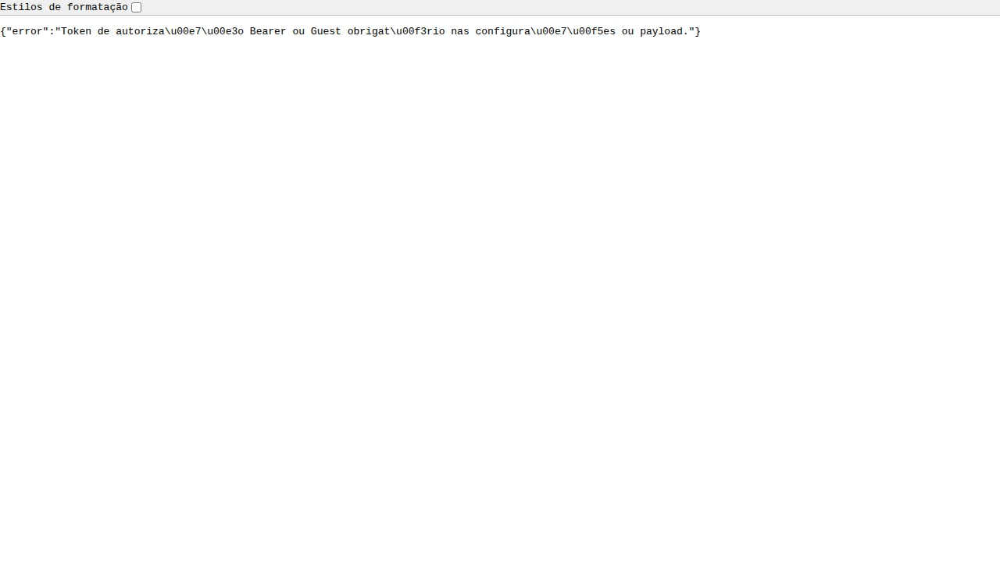

O **TubeMind AI** transforma vídeos longos do YouTube em conhecimento estruturado. Integrado como extensão Chrome **Manifest V3** com portal web dedicado, ele extrai transcrições completas, organiza tópicos com minutagem e gera sínteses objetivas por Inteligência Artificial.

[Abrir TubeMind AI Online](https://4u.ia.br/app/tubemind/) · [Código-Fonte no GitHub](https://github.com/4u-Labs/tubemind) · [Ecossistema 4U.IA.BR](https://4u.ia.br/)

### Funcionalidades em Destaque

- 🚀 🧠 **Resumos & Insights Instantâneos:** Transforme vídeos de 1 hora em listas claras de decisões, conceitos e pontos-chave.
- ⚡ 📜 **Transcrição Completa Pesquisável:** Localize termos falados no vídeo e navegue direto para o timestamp exato.
- 🔒 💬 **Perguntas Contextuais sobre o Vídeo:** Faça perguntas específicas sobre trechos da aula ou palestra sem assistir tudo linearmente.
- 💾 🧩 **Integração Chrome MV3:** Painel lateral limpo rodando direto sobre a página do YouTube.

[Experimentar Online](https://4u.ia.br/app/tubemind/) · [Explorar o Perfil 4u-Labs](https://github.com/4u-Labs)

**TubeMind AI** turns lengthy YouTube videos into structured knowledge. Built as a **Manifest V3** Chrome extension with a companion web hub, it extracts full transcripts, organizes timestamped chapters, and generates crisp AI summaries.

[Open TubeMind AI Online](https://4u.ia.br/app/tubemind/) · [Source Code on GitHub](https://github.com/4u-Labs/tubemind) · [4U.IA.BR Ecosystem](https://4u.ia.br/)

### Key Features

- 🚀 🧠 **Instant AI Video Summaries:** Distill hour-long tutorials and podcasts into clear key takeaways and bullet points.
- ⚡ 📜 **Searchable Full Transcripts:** Search spoken words and jump directly to exact video timestamps.
- 🔒 💬 **Contextual Video Q&A:** Ask targeted questions about specific concepts covered inside any video.
- 💾 🧩 **Native Chrome MV3 Side Panel:** Clean dark-mode interface docked smoothly alongside the YouTube player.

[Try Online](https://4u.ia.br/app/tubemind/) · [Explore 4u-Labs Repositories](https://github.com/4u-Labs)

