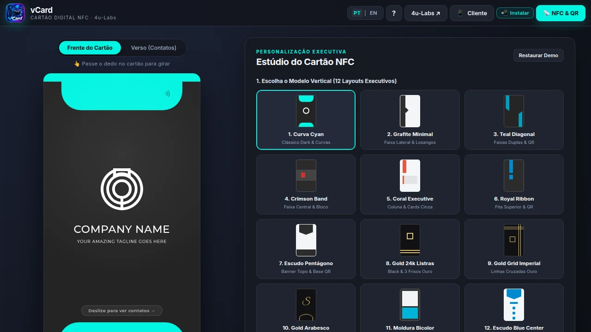

O **vCard Executive NFC** transforma seu cartão de visitas em uma experiência 3D interativa diretamente no navegador. Com suporte bilíngue (PT/EN), modo receptor dedicado e gravação física em chips NFC via Web NFC API, profissionais e empresas compartilham contatos em segundos sem aplicativos intermediários.

[Abrir vCard Executive NFC Online](https://4u.ia.br/app/vcard/) · [Código-Fonte no GitHub](https://github.com/4u-Labs/vcard) · [Ecossistema 4U.IA.BR](https://4u.ia.br/)

### Funcionalidades em Destaque

- 🚀 💳 **12 Temas Executivos & Frente/Verso 3D:** Alterne entre acabamentos metálicos, minimalistas e escuros com rotação suave e pré-visualização instantânea.
- ⚡ 📡 **Gravação Direta em Cartão NFC:** Grave o link ou vCard completo diretamente em cartões plásticos ou etiquetas NTAG via Web NFC no Android.
- 🔒 📲 **Exportação `.vcf` & QR Code Dinâmico:** Salve o contato na agenda nativa do celular com um toque e gere QR Codes prontos para compartilhamento presencial.
- 💾 🔒 **100% Client-Side & Modo PWA:** Dados montados localmente no navegador, sem anúncios ou retenção de cadastros em servidores terceiros.

[Experimentar Online](https://4u.ia.br/app/vcard/) · [Explorar o Perfil 4u-Labs](https://github.com/4u-Labs)

**vCard Executive NFC** turns your business card into an interactive 3D experience right inside the browser. Featuring bilingual PT/EN switching, dedicated visitor receiver mode, and direct Web NFC tag writing, professionals can share contact details instantly without third-party apps.

[Open vCard Executive NFC Online](https://4u.ia.br/app/vcard/) · [Source Code on GitHub](https://github.com/4u-Labs/vcard) · [4U.IA.BR Ecosystem](https://4u.ia.br/)

### Key Features

- 🚀 💳 **12 Executive Themes & 3D Dual Face:** Switch smoothly between metallic, dark, and minimalist finishes with live front/back flip inspection.
- ⚡ 📡 **Direct Web NFC Tag Writing:** Flash your card URL or contact payload straight onto physical NTAG cards or stickers from Android Chrome/Edge.
- 🔒 📲 **One-Tap `.vcf` & Dynamic QR Code:** Export native address-book vCard files and display high-contrast QR Codes for instant offline handoffs.
- 💾 🔒 **100% Client-Side & Installable PWA:** Everything runs locally in the browser with zero ads and zero mandatory cloud accounts.

[Try Online](https://4u.ia.br/app/vcard/) · [Explore 4u-Labs Repositories](https://github.com/4u-Labs)

