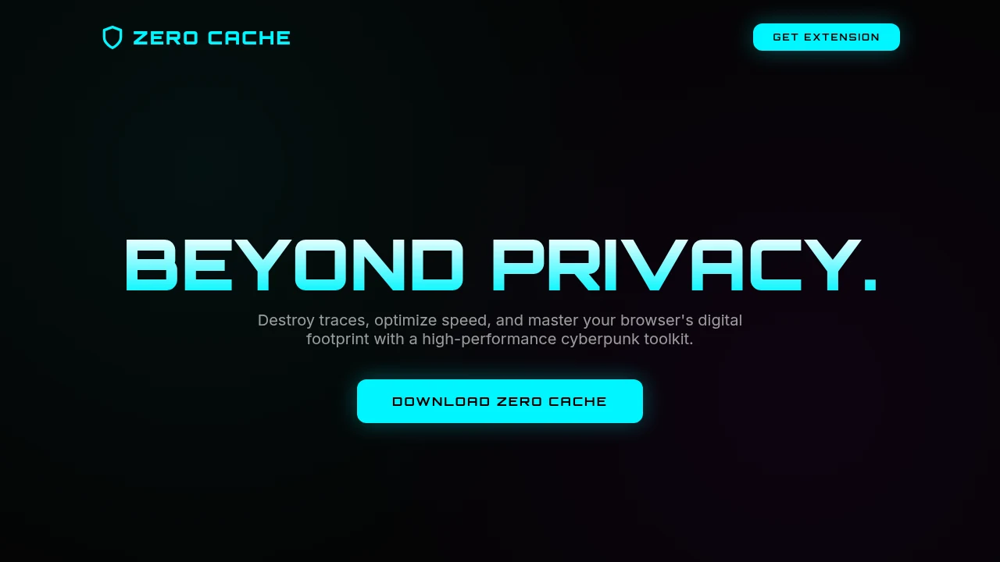

O **Zero Cache** é uma extensão **Manifest V3** ultra-rápida criada para desenvolvedores web e usuários preocupados com privacidade: apague caches persistentes, cookies de rastreamento, `localStorage` e dados temporários em segundos com controle granular.

[Abrir Zero Cache Online](https://4u.ia.br/app/zerocache/) · [Código-Fonte no GitHub](https://github.com/4u-Labs/zerocache) · [Ecossistema 4U.IA.BR](https://4u.ia.br/)

### Funcionalidades em Destaque

- 🚀 🧹 **Limpeza Seletiva em 1 Clique:** Escolha exatamente entre cache HTTP, cookies, histórico, Service Workers e dados de formulário.
- ⚡ 🛠️ **Essencial para Devs Frontend:** Force o recarregamento limpo de builds, CSS e scripts sem abrir o DevTools toda vez.
- 🔒 🛡️ **Arquitetura Manifest V3 Sem Telemetria:** Permissões mínimas e zero envio de histórico de navegação.
- 💾 ⚡ **Pop-up Leve & Modo Escuro:** Interface limpa com feedback imediato de conclusão.

[Experimentar Online](https://4u.ia.br/app/zerocache/) · [Explorar o Perfil 4u-Labs](https://github.com/4u-Labs)

**Zero Cache** is an ultra-fast **Manifest V3** browser extension designed for web developers and privacy-conscious users: wipe stubborn HTTP caches, tracking cookies, and site storage cleanly in one click.

[Open Zero Cache Online](https://4u.ia.br/app/zerocache/) · [Source Code on GitHub](https://github.com/4u-Labs/zerocache) · [4U.IA.BR Ecosystem](https://4u.ia.br/)

### Key Features

- 🚀 🧹 **Granular 1-Click Purge:** Selectively clear browser cache, cookies, browsing history, Service Workers, and form data.
- ⚡ 🛠️ **Frontend Dev Workflow Essential:** Bypass stale assets and cached bundles effortlessly while testing builds.
- 🔒 🛡️ **Telemetry-Free Manifest V3 Design:** Minimal permissions with zero external tracking or data collection.
- 💾 ⚡ **Instant Dark-Mode Popup:** Featherweight UI delivering immediate cleanup confirmation.

[Try Online](https://4u.ia.br/app/zerocache/) · [Explore 4u-Labs Repositories](https://github.com/4u-Labs)

