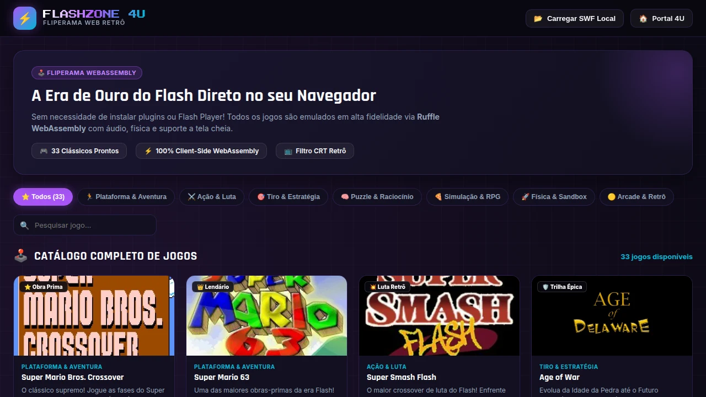

Durante mais de duas décadas, os jogos em **Adobe Flash** definiram uma geração inteira da web, revelando mecânicas criativas e títulos inesquecíveis em portais de browser games. Com a descontinuação oficial do Flash Player em 2020, grande parte desse acervo histórico ficou inacessível nos navegadores modernos. O **FlashZone 4U** nasce para preservar e reviver essa era de ouro diretamente no navegador, rodando **100% client-side via WebAssembly (Ruffle)** — sem instalar plugins, sem cadastro e sem anúncios.

[Acessar FlashZone 4U](https://4u.ia.br/app/flashzone/) · [Código-Fonte no GitHub](https://github.com/4u-Labs/flashzone) · [Ecossistema 4U.IA.BR](https://4u.ia.br/)

### Funcionalidades em Destaque

- 🚀 **Catálogo com +33 Clássicos Lendários:** Inclui *Super Mario Bros. Crossover*, *Super Mario 63*, *Super Smash Flash*, *Age of War*, *Stick War*, *Bloxorz*, *The Impossible Quiz*, *The World's Hardest Game*, *Learn to Fly*, *Bloons TD 2*, *Motherload*, *Henry Stickmin*, *Portal: The Flash Version*, *Line Rider*, *Electricman 2* e muitos outros, organizados por categoria com busca instantânea.
- ⚡ **Emulação 100% Client-Side com Ruffle (Rust/WASM + WebGL):** O emulador open-source **Ruffle** executa os arquivos `.swf` diretamente na sandbox segura do seu navegador com aceleração WebGL e altíssima fluidez, sem depender do antigo plugin NPAPI.
- 📺 **Filtro CRT Scanlines, Tela Cheia e Reinício Rápido:** Recrie a atmosfera de monitores e TVs de tubo dos anos 90/2000 com 1 clique, alterne para tela cheia e reinicie a partida instantaneamente.
- 📂 **Carregador de Arquivos `.swf` Locais:** Possui algum jogo ou animação Flash guardado no computador? Arraste e solte qualquer arquivo `.swf` diretamente na interface do FlashZone para executá-lo localmente na hora — nada é enviado para servidores externos.
- 🔒 **Privacidade & Zero Fricção:** Execução totalmente no navegador, zero rastreadores invasivos, interface responsiva em tema Dark Arcade e acesso instantâneo com 1 clique.

[Experimentar FlashZone Online](https://4u.ia.br/app/flashzone/) · [Explorar o Perfil 4u-Labs](https://github.com/4u-Labs)

For over two decades, **Adobe Flash** games defined an entire generation of web culture, pioneering indie mechanics and unforgettable browser classics. After Adobe officially discontinued Flash Player in 2020, much of that interactive history became unplayable on modern browsers. **FlashZone 4U** brings that golden era back to life right inside your browser, running **100% client-side via Ruffle WebAssembly** — with zero plugins, no sign-up, and no ads.

[Open FlashZone 4U](https://4u.ia.br/app/flashzone/) · [Source Code on GitHub](https://github.com/4u-Labs/flashzone) · [4U.IA.BR Ecosystem](https://4u.ia.br/)

### Key Features

- 🚀 **33+ Curated Flash Classics:** Play *Super Mario Bros. Crossover*, *Super Mario 63*, *Super Smash Flash*, *Age of War*, *Stick War*, *Bloxorz*, *The Impossible Quiz*, *The World's Hardest Game*, *Learn to Fly*, *Bloons TD 2*, *Motherload*, *Henry Stickmin*, *Portal: The Flash Version*, *Line Rider*, *Electricman 2*, and more, with real-time search and category filters.
- ⚡ **100% Client-Side Ruffle Emulation (Rust/WASM + WebGL):** Powered by the open-source **Ruffle** emulator, `.swf` titles execute safely inside your browser sandbox with WebGL rendering and smooth performance — no legacy browser plugins required.
- 📺 **CRT Scanlines Filter, Fullscreen & Quick Reset:** Toggle a retro 90s/2000s CRT scanline shader in one click, jump into fullscreen mode, and restart any game instantly.
- 📂 **Local `.swf` File Loader:** Still have classic Flash games or animations saved on your computer? Drag and drop any local `.swf` file straight into FlashZone to run it locally in your browser — nothing is uploaded to any server.
- 🔒 **Privacy & Zero Friction:** Fully client-side emulation, responsive Dark Arcade UI, no invasive trackers, and instant 1-click gameplay.

[Try FlashZone Online](https://4u.ia.br/app/flashzone/) · [Explore 4u-Labs Repositories](https://github.com/4u-Labs)

