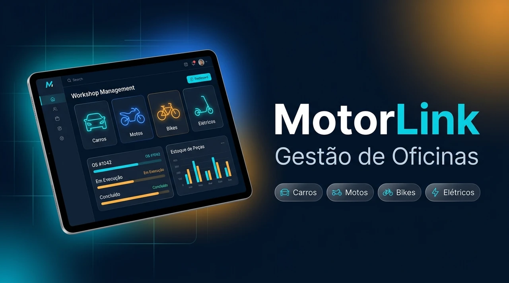

Oficinas modernas não atendem mais apenas automóveis a combustão: o mesmo espaço hoje recebe **carros, motocicletas, bicicletas, e-bikes e patinetes elétricos**, exigindo controle independente de **tipo de veículo** e **motorização** (combustão, elétrica, híbrida ou tração humana). O **MotorLink** foi desenvolvido no ecossistema **4U.IA.BR** para unir **Ordens de Serviço**, **inspeção visual**, **estoque de peças com reserva automática** e **recebimentos** em um aplicativo leve, instalável como **PWA** e sem dependências de frameworks pesados.

[Acessar MotorLink](https://4u.ia.br/app/motor/) · [Código-Fonte no GitHub](https://github.com/4u-Labs/motorlink) · [Ecossistema 4U.IA.BR](https://4u.ia.br/)

### Funcionalidades em Destaque

- 🚗 **Suporte Multi-Veículos & Motorização Independente:** Cadastre carros, motos, bicicletas e patinetes escolhendo combustão, elétrico, híbrido ou humano, com campos dedicados para placa/serial, quilometragem e leituras de bateria EV (tensão, capacidade e saúde).
- 📋 **Fluxo Completo de Ordem de Serviço (OS):** Acompanhe desde a entrada (*Recebido*), *Diagnóstico* e *Orçamento/Aprovação* até *Em Reparo*, *Pronto* e *Entregue*, com aprovação explícita do cliente, histórico imutável de transições e impressão em A4/PDF.
- 🔍 **Checklist de Inspeção Dinâmico & Fotos:** Checklist adaptado automaticamente para veículos elétricos/híbridos (bateria, conector, motor) ou a combustão, permitindo anexar até 5 fotografias comprimidas no cliente e validação de integridade no backend.
- 📦 **Estoque com Baixa Automática & Concorrência Segura:** Reserva e baixa automática de peças ao iniciar o reparo, devolução em caso de cancelamento e controle de conflito otimista por revisão (`version`) em SQLite WAL.
- 🔒 **Três Modos de Trabalho (Demo, Local Offline e Nuvem):** Experimente na hora com dados fictícios no navegador, opere offline no modo Local ou sincronize seu workspace privado via Google Identity + hub 4u-Labs, com exportação JSON e CSV.

[Experimentar MotorLink Online](https://4u.ia.br/app/motor/) · [Explorar o Perfil 4u-Labs](https://github.com/4u-Labs)

Modern repair shops go far beyond combustion cars: today’s workshops service **cars, motorcycles, bicycles, e-bikes, and electric scooters**, requiring independent tracking of **vehicle type** and **powertrain** (combustion, electric, hybrid, or human-powered). Built within the **4U.IA.BR** ecosystem, **MotorLink** unifies **Work Orders**, **photo-backed inspections**, **stock-aware parts billing**, and **payment tracking** inside a lightweight **PWA** crafted with PHP, SQLite, and vanilla JavaScript.

[Open MotorLink](https://4u.ia.br/app/motor/) · [Source Code on GitHub](https://github.com/4u-Labs/motorlink) · [4U.IA.BR Ecosystem](https://4u.ia.br/)

### Key Features

- 🚗 **Multi-Vehicle & Powertrain Modeling:** Manage cars, motorcycles, bicycles, and scooters across combustion, electric, hybrid, and human drivetrains, including serial numbers, mileage, and EV battery readings (voltage, capacity, and health).
- 📋 **Structured Work Order Workflow:** Track every job from *Received*, *Diagnosis*, and *Customer Approval* to *Repair*, *Ready*, and *Delivered*, enforcing recorded customer approval, immutable status timelines, and clean browser A4/PDF printing.
- 🔍 **Adaptive Inspection Checklist & Photo Attachments:** Dynamic inspection checklists tailored to electric/hybrid drivetrains (battery, connector, motor) or combustion engines, with client-side image compression (up to 5 photos per order) and strict server-side image validation.
- 📦 **Automatic Inventory Deduction & Optimistic Locking:** Parts are reserved/deducted once approved work enters repair and released on cancellation, backed by strict SQLite WAL transactions and revision-based (`version`) conflict detection.
- 🔒 **Three Work Modes (Demo, Local Offline, and Cloud):** Test instantly with sample data, run offline in Local storage mode, or sync a private server workspace using Google authentication and JSON/CSV portability.

[Try MotorLink Online](https://4u.ia.br/app/motor/) · [Explore 4u-Labs Repositories](https://github.com/4u-Labs)

