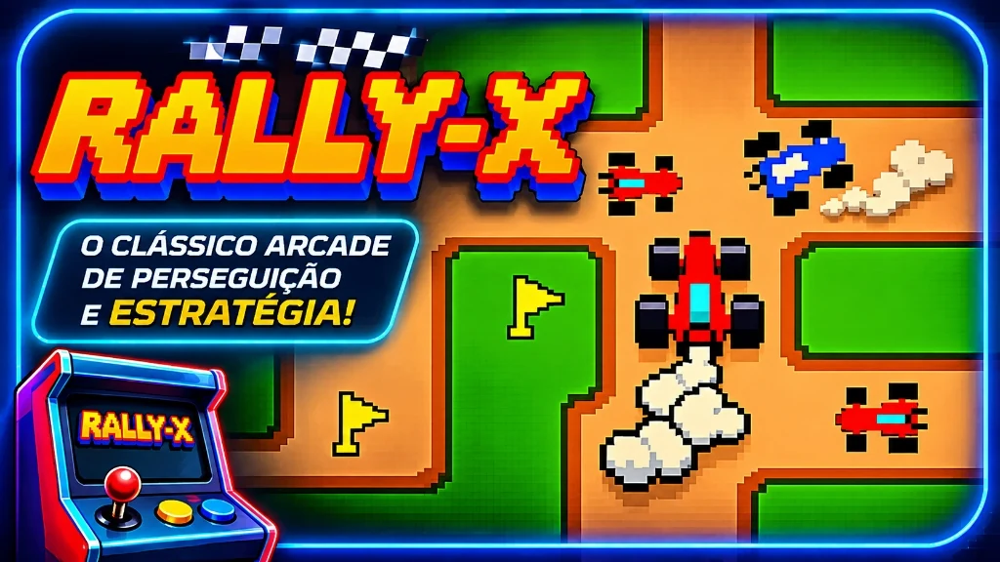

Lançado originalmente nos fliperamas em 1980 (seguido pelo *New Rally-X* em 1981), **Rally-X** marcou a história dos videogames ao combinar perseguição em labirintos, trilha sonora contínua e um dos primeiros minimapas/radares em tempo real da história. O **Rally-X Retro Console** traz essa experiência autêntica para o ecossistema **4U.IA.BR**, rodando 100% no navegador dentro de um gabinete retrô com monitor CRT, laterais amadeiradas, chaves metálicas e joystick arcade multi-touch.

[Acessar Rally-X Retro Console](https://4u.ia.br/app/rallyx/) · [Código-Fonte no GitHub](https://github.com/4u-Labs/rallyx) · [Ecossistema 4U.IA.BR](https://4u.ia.br/)

### Funcionalidades em Destaque

- 🏎️ **Gráficos Pixel-Art Fidedignos (288×224 nativo):** Carrinhos F1 *open-wheel* em 8 direções com quadros diagonais de 45° nas curvas, nuvens de fumaça orgânicas que paralisam os perseguidores, bandeiras normais, *Special Flag (2×)*, *Lucky Flag (1981)*, pedras e fonte arcade 8×8 própria.
- 🕹️ **Console Retrô Interativo & Multi-Touch:** Gabinete com marquee iluminado, efeito CRT opcional, chaves metálicas ao vivo para alternar entre **Edição 1980** e **1981** ou nível **Normal / Pro**, além de joystick de 4 direções e botão vermelho **SMOKE** independentes para celular e desktop.
- 🎵 **Áudio Arcade Sintetizado via Web Audio API:** Fanfarra inicial de 3 vozes, trilha principal de 151 BPM em loop contínuo sem distorção, tema de *Challenging Stage* e efeitos sonoros gerados em tempo real sem arquivos externos.
- 🔒 **Privacidade Total & PWA Offline:** Execução 100% client-side, sem anúncios, sem rastreamento, com placar Top 5 salvo localmente e suporte instalável como Progressive Web App (PWA) sob licença livre **GNU AGPL-3.0**.

[Experimentar Rally-X Online](https://4u.ia.br/app/rallyx/) · [Explorar o Perfil 4u-Labs](https://github.com/4u-Labs)

Originally released in arcades in 1980 (followed by *New Rally-X* in 1981), **Rally-X** made video game history by blending high-speed maze chases, continuous background music, and one of the earliest real-time radar mini-maps. **Rally-X Retro Console** brings that authentic experience to the **4U.IA.BR** ecosystem, running 100% in your browser inside a tactile 1980s CRT cabinet with walnut side panels, metal toggle switches, and a multi-touch arcade deck.

[Open Rally-X Retro Console](https://4u.ia.br/app/rallyx/) · [Source Code on GitHub](https://github.com/4u-Labs/rallyx) · [4U.IA.BR Ecosystem](https://4u.ia.br/)

### Key Features

- 🏎️ **Authentic Pixel-Art Engine (Native 288×224):** Open-wheel F1 racers with 8-direction sprites including 45° cornering frames, billowing smoke clouds that spin out pursuing red cars, standard flags, *Special Flag (2×)*, *Lucky Flag (1981)*, rocks, and a custom pixel bitmap font.
- 🕹️ **Interactive Retro Console & Multi-Touch Deck:** Illuminated marquee, toggleable CRT scanlines, live hardware switches for **1980 / 1981 Edition** and **Normal / Pro Skill**, plus simultaneous drag-and-tap 4-way joystick and concave **SMOKE** button for mobile and desktop.
- 🎵 **Pure Web Audio API Chiptune Synthesizer:** 3-voice starting fanfare, crisp 151 BPM looping main arcade theme, Challenging Stage melody, and real-time synthesized sound effects with zero external audio assets.
- 🔒 **Zero-Tracking Privacy & Offline PWA:** 100% client-side execution with no ads or accounts, local Top-5 high-score persistence, bilingual PT/EN UI, and installable offline Progressive Web App support under **GNU AGPL-3.0**.

[Try Rally-X Online](https://4u.ia.br/app/rallyx/) · [Explore 4u-Labs Repositories](https://github.com/4u-Labs)

